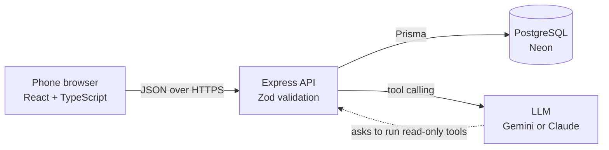

# AV Gear Tracker

A mobile-first web app for checking camera gear in and out by scanning QR labels, with an AI assistant that answers questions about the inventory.

**Live demo:** _coming soon_ · sample data only · the free server can take ~30 seconds to wake up

> I built this to replace a temporary Google Sheets tool after rented camera gear kept coming back with items missing and nobody could say who had what.

## Features
- **Scan to cart:** scan several QR labels with a phone camera (or type IDs), then check everything out to one person in one step
- **Check in:** scan returned gear back in, including partial returns (2 of 3 items back, the third still shows as out)
- **Still out:** everything currently checked out, grouped by person
- **AI assistant:** ask "Who has the Canon kit?" in plain English; an LLM (Google Gemini or Anthropic Claude) answers using read-only tools over the database
- **QR labels:** printable labels for every item
- **Demo reset:** one click restores the sample data

## Tech stack
| Layer | Tools |
| --- | --- |
| Frontend | React 19, TypeScript, Vite, html5-qrcode |
| Backend | Node.js, Express 5, TypeScript, Zod |
| Database | PostgreSQL on Neon, Prisma 7 ORM with migrations |
| AI | LLM tool calling: Google Gemini (free tier) or Anthropic Claude |
| Testing / CI | Vitest, ESLint, GitHub Actions |
| Hosting | Render (API + static site), Neon (database) |

## Architecture

The browser only talks to the API. The API is the only thing that touches the database or holds the AI key.

## How the important parts work
**Transactional checkout.** Checking out a cart creates a checkout, links every item, and marks items `OUT` inside one database transaction, so a cart is saved completely or not at all. A race-condition guard updates only items still `IN`; if two people scan the same battery at once, one request wins and the other rolls back with a `409 Conflict`.

**Data model.** `people` → `checkouts` → `checkout_items` ← `items`. The `checkout_items` join table stores a `returned_at` per item, which makes partial returns and per-item history possible.

**AI with tool calling.** The model never writes SQL or touches the database. It can only request four read-only functions (`search_items`, `get_open_checkouts`, `get_item_history`, `list_people`); the API runs them and sends results back. Questions are rate-limited per visitor to cap cost.

**Input validation.** Zod checks every request body and cleans scanned IDs (trims, upper-cases, removes duplicate scans) before anything reaches the database.

## API
| Method | Path | Description |
| --- | --- | --- |
| GET | `/api/health` | Health check |
| GET | `/api/items?status=&search=` | List or search items |
| GET | `/api/items/:id` | One item |
| GET | `/api/people` | Team members |
| POST | `/api/checkouts` | Check out a cart: `{ personId, itemIds }` |
| POST | `/api/checkins` | Check items back in: `{ itemIds }` |
| GET | `/api/checkouts/open` | Everything still out, grouped by person |
| POST | `/api/assistant` | Ask the AI assistant: `{ question }` |
| POST | `/api/demo/reset` | Restore sample data (demo mode only) |

## Run it locally
Requires Node 22+ and a Postgres connection string (a free [Neon](https://neon.com) database works).

```bash
npm install
cp apps/api/.env.example apps/api/.env   # then fill in DATABASE_URL
npm run db:deploy --workspace apps/api   # create tables
npm run db:seed --workspace apps/api     # load sample data
npm run dev:api                          # API on http://localhost:3000
npm run dev:web                          # website on http://localhost:5173
```

## Project structure
```
apps/
  api/   Express API, Prisma schema + migrations, seed data, tests
  web/   React + TypeScript frontend
.github/workflows/ci.yml   lint, type-check, test, build on every PR
render.yaml                deploy blueprint for Render
```
